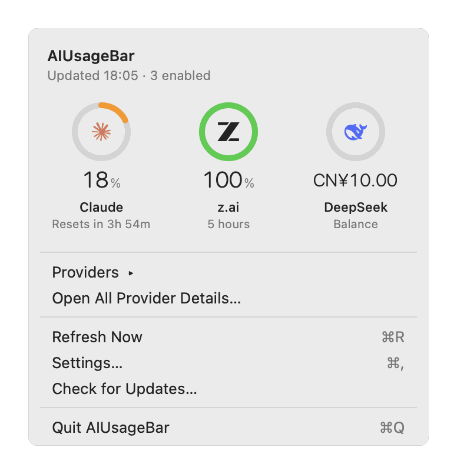
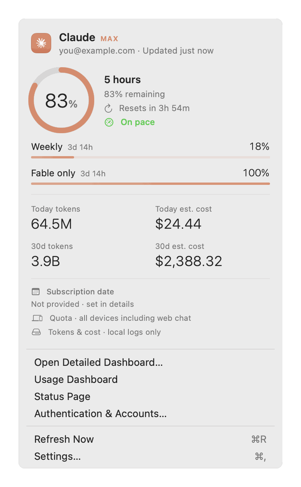
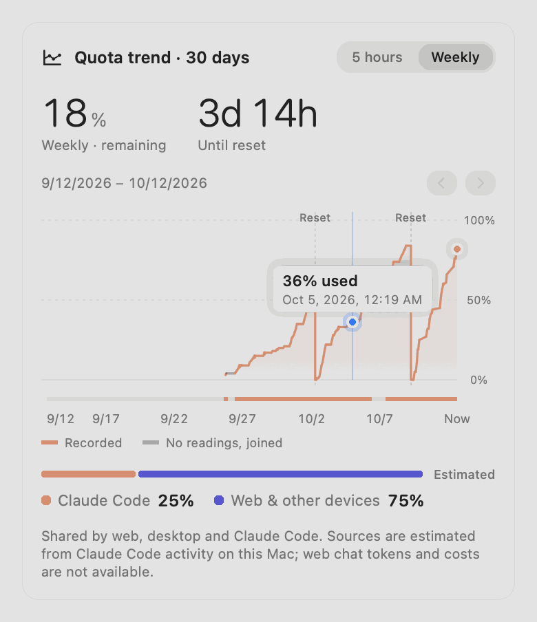
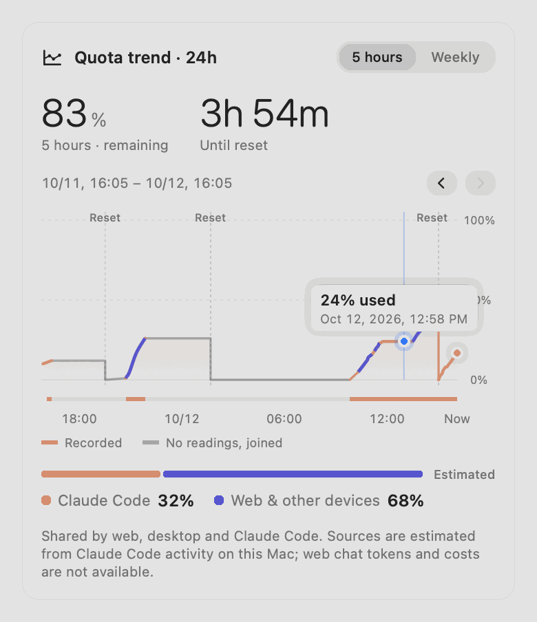
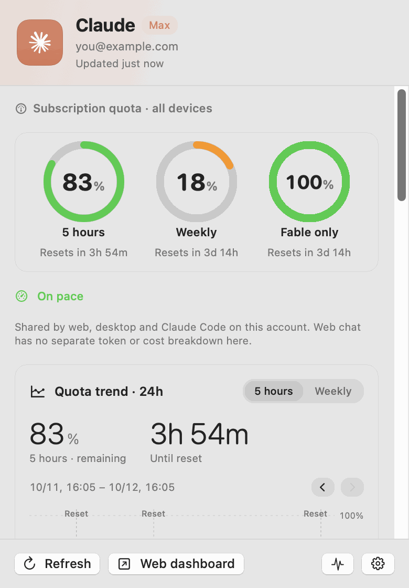
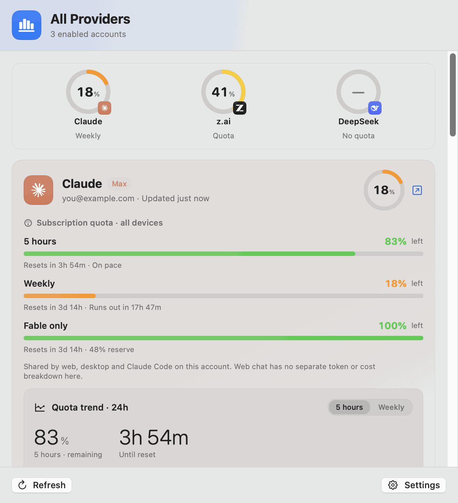
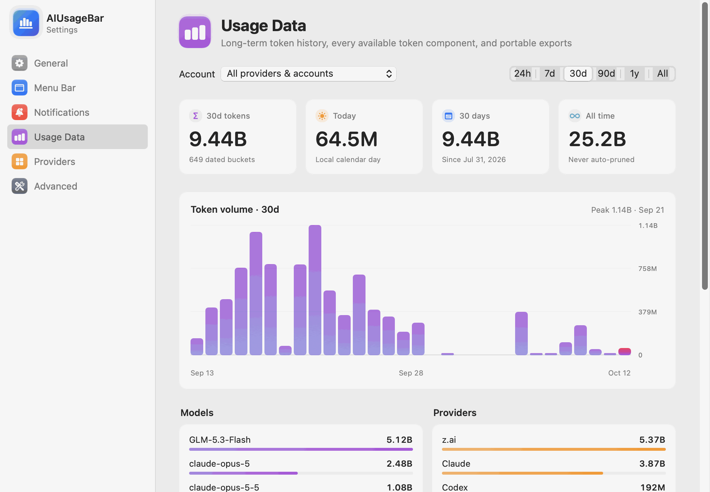
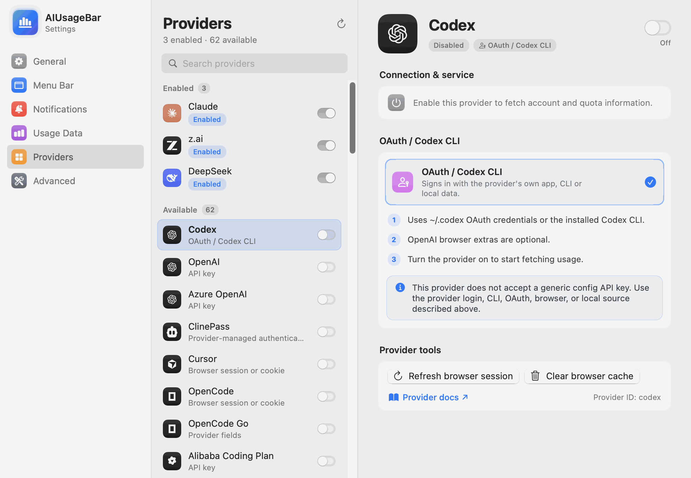
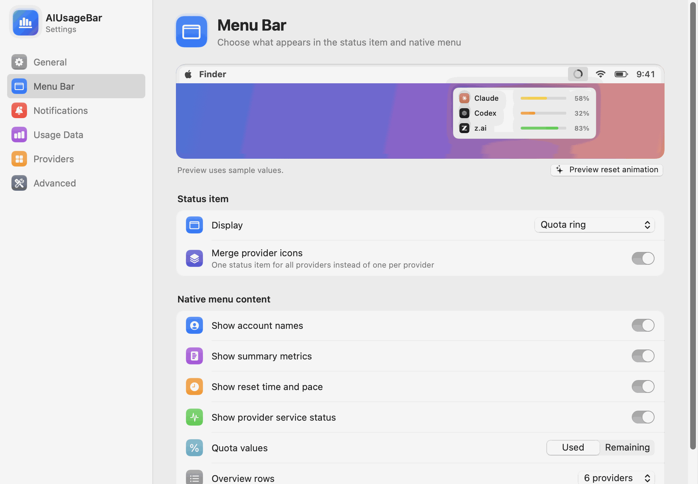

# AIUsageBar

<p align="center">English · <a href="README.zh-CN.md">简体中文</a></p>

<p align="center">
<picture><source media="(prefers-color-scheme: dark)" srcset="docs/screenshots/en/menu-overview-dark.png"></picture>
</p>
<p align="center">
<picture><source media="(prefers-color-scheme: dark)" srcset="docs/screenshots/en/status-items-dark.png"></picture>
</p>

<p align="center"><b>Every AI quota, reset and dollar — one glance from the menu bar.</b><br>
A native menu-bar app for macOS 12 Monterey and later, powered by the full CodexBar provider engine.</p>

## Highlights

### Your quotas, at a glance

<p align="center">
<picture><source media="(prefers-color-scheme: dark)" srcset="docs/screenshots/en/menu-claude-dark.png"></picture>
</p>

- **A ring per provider**, like the battery widget: colored by how much is left, with the brand logo inside and the reset countdown underneath. Rows sort with the scarcest quota first.
- **Menu-bar ring** that turns red below 15% — or show the used or remaining percentage, or the provider icon.
- **Pace forecasts** ("Runs out in 17h 47m", "On pace") for every window, and a little celebration when a quota resets: the ring refills, then glows.

### A quota trend you can actually read

<table>
<tr>
<td valign="top"><picture><source media="(prefers-color-scheme: dark)" srcset="docs/screenshots/en/quota-trend-weekly-hover-dark.png"></picture></td>
<td valign="top"><picture><source media="(prefers-color-scheme: dark)" srcset="docs/screenshots/en/quota-trend-five-hour-hover-dark.png"></picture></td>
</tr>
</table>

- **One continuous line** across the whole subscription month. Stretches the Mac slept through are joined in gray, and every reset drops at its exact time.
- **Hover anywhere** for a blue dot snapped to the real reading, with the usage and when it was read.
- **Swipe, drag or step** back through history that is **kept forever** (about 15 KB a day). The strip under the curve marks exactly when readings were recorded.
- **Where the quota went:** Claude's official per-product breakdown (Claude Code, Cowork, chats) when your account reports it, or an estimate of Claude Code versus web and other devices from local activity.

### Details for one provider, or all of them

<table>
<tr>
<td valign="top"><picture><source media="(prefers-color-scheme: dark)" srcset="docs/screenshots/en/detail-claude-dark.png"></picture></td>
<td valign="top"><picture><source media="(prefers-color-scheme: dark)" srcset="docs/screenshots/en/all-providers-dark.png"></picture></td>
</tr>
</table>

### Usage data that never disappears

<picture><source media="(prefers-color-scheme: dark)" srcset="docs/screenshots/en/settings-usage-data-dark.png"></picture>

- A local token ledger that is **never pruned**: 24 hours to all time, by model and by provider, with CSV and full JSON export.
- Cost estimates at API prices, with unknown prices left as gaps rather than drawn as zero; partial totals are marked `≥`.

### 60+ providers, set up in a few clicks

<table>
<tr>
<td valign="top"><picture><source media="(prefers-color-scheme: dark)" srcset="docs/screenshots/en/settings-providers-dark.png"></picture></td>
<td valign="top"><picture><source media="(prefers-color-scheme: dark)" srcset="docs/screenshots/en/settings-menu-bar-dark.png"></picture></td>
</tr>
</table>

- Every provider the upstream engine registers, with official logos, step-by-step authentication guidance, and a live preview of the menu bar while you choose its style.

<sub>Screenshots are rendered from the app's own views with real usage data; account details are replaced with placeholders.</sub>

## What's included

> Renamed from an earlier project name. On first launch the app moves settings, usage history, the provider config file and the launch-at-login agent from installs made before the rename.

A macOS 12 menu-bar app for AI usage, quotas and spend. It bundles the complete provider engine from the upstream [CodexBar](https://github.com/steipete/CodexBar) project (MIT) and ships as a Sparkle-ready whole bundle.

The project pins an upstream CodexBar release in `ENGINE_VERSION`, builds its shared `CodexBarCore + CodexBarCLI`, embeds the CLI as the app's usage engine (`Contents/Helpers/AIUsageEngine`), and replaces only the macOS 14 UI layer with AppKit compatible with Monterey.

Included:

- all providers registered by the pinned upstream tag;
- upstream browser-cookie, CLI/RPC/PTY, OAuth, API-key, cloud-credential, local-file/database, cost, and status paths;
- provider enable/disable, API-key, cookie refresh, and cache controls;
- merged or per-provider menu-bar presentation with four status-item display styles;
- a native macOS status menu with configurable overview rows, provider/account submenus, quota pace, resets, metrics, and service state;
- native, status-item-anchored provider detail popovers with explicit quota labels and separately labeled token/cost history charts;
- no duplicate fixed-dark dashboard popover entry; both provider detail and all-provider overview use native status-item popovers following system appearance;
- Manual, fixed, and adaptive refresh modes, refresh-on-open, transition-based service/quota notifications, and VoiceOver labels;
- account-isolated local quota/spend history, plus an unpruned Application Support token ledger that imports Codex/Claude token components and z.ai hourly/model buckets;
- Claude history attributed by actual model, with third-party Claude Code models retained separately from Claude and excluded from combined totals to avoid overlap with provider API history;
- persistent Codex/Claude per-model token breakdowns, reconciled before splitting mixed days; unknown prices remain missing, and local API cost estimates are explicitly distinct from subscription bills or official quota use;
- known cost subtotals remain visible in summary cards and daily charts with `≥`, partial-estimate labels, and unpriced-model details; only fully unknown costs leave chart gaps. Top-model summaries separately rank the last 10 local calendar days (including today) and today by tokens;
- a Settings → Usage Data page with 24h/7d/30d/90d/1y/all-time charts, provider/model breakdowns, visible CSV export, and full JSON export;
- z.ai compact views prioritize and label the five-hour allowance while retaining MCP/monthly windows in full details;
- universal arm64/x86_64 packaging;
- Sparkle 2.9.4 integration; a signed update channel still requires a real appcast/key configuration;
- optional Developer ID signing and notarization;
- daily upstream release checks and macOS 12 deployment-target verification; automated PR creation also requires the repository setting that permits GitHub Actions to create pull requests.

Provider-specific raw output remains available through the bundled CLI. The app does not port WidgetKit, every bespoke animation, or every provider-specific login surface, and does not claim pixel-perfect parity with the macOS 14+ upstream UI.

GitHub Actions runs behavioral Swift tests, Monterey backport regressions, release-contract checks, and recursive Universal 2 validation. Swift 5.6 machines can still run the lightweight parser, history, authentication, and patcher regressions without building the full Swift 6.2 package.

## Local UI validation on Swift 5.6

When the machine cannot load the Swift 6.2 package manifest, it can still build the current AppKit/SwiftUI shell directly for both `arm64` and `x86_64`. The script copies the usage engine, Sparkle, and other resources from an already installed or otherwise validated template app, replaces only the UI executable, ad-hoc signs the result, and runs the recursive offline bundle checks:

```bash
AIUSAGEBAR_LOCAL_TEMPLATE_APP="/Applications/AIUsageBar.app" \
AIUSAGEBAR_LOCAL_VERSION="0.10.0" \
Scripts/build_local_validation.sh
```

To exercise the real menu and provider-detail popover before the script exits, quit any running AIUsageBar instance and add `AIUSAGEBAR_LOCAL_RUN_UI_SMOKE=1`. Install an accepted local bundle with `Scripts/install_local.sh "/absolute/path/to/the.app"`; the installer keeps the previous app in a recoverable `/private/tmp` backup.

This is a UI/interaction validation path, not a release build: the helper and Sparkle framework come from the template, the main executable uses the no-Sparkle fallback, and the bundle is only ad-hoc signed. GitHub Actions or a complete Swift 6.2 local build remains authoritative for the pinned provider engine, Sparkle linkage, and release archive.

See [README.zh-CN.md](README.zh-CN.md) for the complete setup and release guide.
